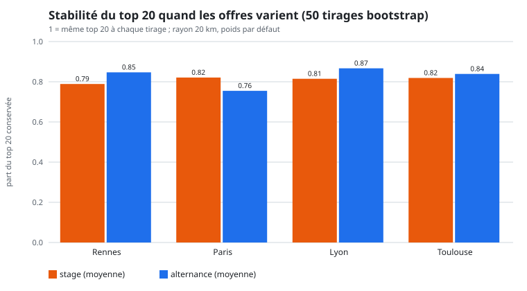
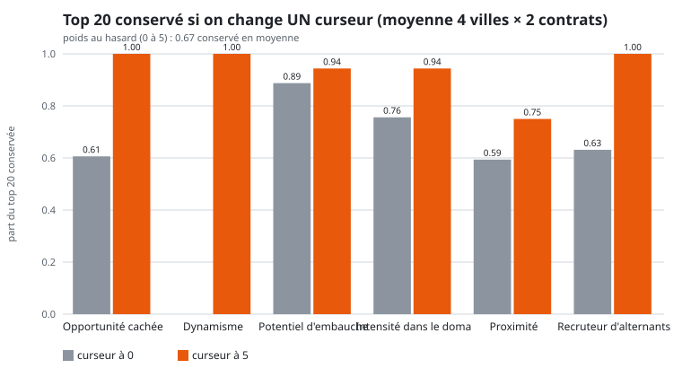
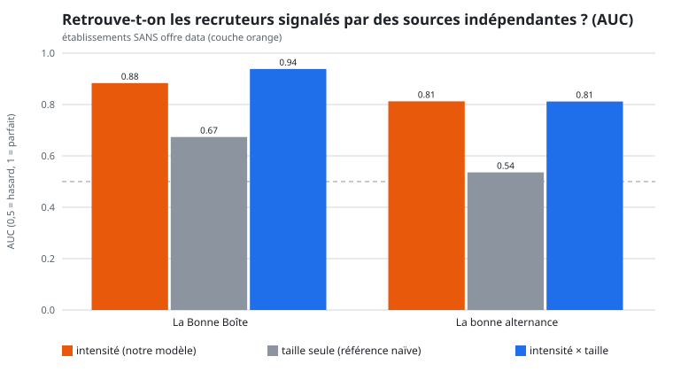

# Validation du score sans vérité terrain (T34)

> Résultats du 2026-11-27 sur les **vraies données** (406 266 établissements, 1 738 offres data rapprochées, scores avec La Bonne Boîte).
> Reproduire : `uv run python scripts/validate_scores.py` (~15 min) → `data/processed/validation/` (JSON, CSV, graphiques).
> Code : `radar/validation.py`. Graphiques prêts pour les slides : `docs/figures/validation_*.svg`.

## Pourquoi « sans vérité terrain »

Aucune donnée ouverte ne dit « cette entreprise a accepté un stagiaire après une candidature spontanée ». On ne peut donc pas mesurer une précision. On vérifie à la place trois propriétés qu'un bon classement doit avoir :

1. **Stabilité** : si on avait observé un peu d'autres offres, le classement serait-il le même ?
2. **Robustesse aux poids** : le classement dépend-il d'un réglage précis des curseurs ?
3. **Cohérence externe** : notre modèle retrouve-t-il des entreprises que **d'autres sources, indépendantes de nos offres**, signalent comme recrutant en data ?

**Ce qui est mesuré :** le classement de la **couche orange** (candidatures spontanées), exactement celui de l'app (`rank_spontaneous`, poids par défaut). On regarde le **top 20** (la taille d'une liste qu'un étudiant lit vraiment), dans un rayon de 20 km, pour Rennes, Paris, Lyon et Toulouse, en stage et en alternance. Le recalcul reproduit les scores de production (écart ≤ 3 × 10⁻⁸).

## 1. Stabilité : bootstrap sur les offres

**Méthode :** 50 fois, on tire les 1 738 offres data **avec remise** (certaines comptent deux fois, d'autres disparaissent), on recalcule l'intensité (gamma-Poisson, D13) et le potentiel d'embauche (D27), puis on compare le top 20 au top 20 observé.

| Ville | Stage : top 20 conservé (moyenne / pire 10 %) | Alternance |
|---|---|---|
| Rennes | **79 %** / 70 % | **85 %** / 80 % |
| Paris | **82 %** / 75 % | **76 %** / 65 % |
| Lyon | **82 %** / 75 % | **87 %** / 80 % |
| Toulouse | **82 %** / 70 % | **84 %** / 80 % |

**Lecture :** en moyenne, **8 entreprises sur 10 du top 20 restent dans le top 20** quand les offres observées changent. Le classement ne repose pas sur quelques offres isolées : c'est l'effet du rétrécissement bayésien (une entreprise avec une seule offre ne passe pas devant tout le monde). Le cœur de la liste est solide, la fin de liste bouge un peu.

## 2. Sensibilité aux poids (curseurs)

**Méthode :** (a) on met **un** curseur à 0 puis à 5, les autres restant par défaut ; (b) 50 jeux de poids tirés au hasard (chaque curseur entre 0 et 5) par ville × contrat.

| Curseur modifié | Top 20 conservé, curseur à 0 | à 5 |
|---|---|---|
| Intensité dans le domaine | 76 % | 94 % |
| Potentiel d'embauche | 89 % | 94 % |
| Proximité | 59 % | 75 % |
| Opportunité cachée | 61 % | 100 % |
| Recruteur d'alternants (LBA) | 63 % | 100 % |
| Dynamisme | — (déjà à 0) | 100 % (constant tant que T22 n'est pas faite) |

Poids au hasard : top 20 conservé en moyenne de **52 %** (Paris, alternance) à **83 %** (Lyon, stage) ; médiane souvent ≥ 75 %.

**Lecture :**
- Les petits réglages ne bouleversent pas la liste : changer l'intensité ou le potentiel d'embauche garde 76 à 94 % du top 20.
- Les curseurs **Proximité**, **Opportunité cachée** et **Recruteur LBA** changent vraiment la liste, ce qui est **voulu** : ce sont des préférences de l'étudiant (rester près de chez lui, viser les entreprises qui recrutent déjà dans le domaine). Les curseurs servent donc à quelque chose.
- Des poids extrêmes tirés au hasard peuvent donner une liste très différente (jusqu'à 0 % commun) : c'est normal, et c'est pourquoi l'app part de **poids par défaut raisonnables**.

## 3. Cohérence avec des sources indépendantes

**Méthode :** AUC (probabilité qu'un établissement signalé ait un meilleur score qu'un établissement non signalé ; 0,5 = hasard, 1 = parfait), calculée sur les **396 398 établissements sans offre data**, c'est-à-dire exactement la population de la couche orange : notre modèle n'y a vu aucune offre, il doit « deviner » le besoin.

Étiquettes **indépendantes de nos offres** :
- **La Bonne Boîte** (France Travail) : 1 133 établissements listés sur un métier data, d'après les déclarations d'embauche ;
- **La bonne alternance** : 11 150 recruteurs potentiels sur un code ROME data.

Référence naïve : « les plus gros établissements d'abord » (effectif seul).

| AUC (établissements sans offre data) | Notre intensité | Taille seule (référence) | Intensité × taille |
|---|---|---|---|
| Retrouve les établissements La Bonne Boîte | **0,88** | 0,67 | **0,94** |
| Retrouve les recruteurs La bonne alternance | **0,81** | 0,54 | 0,81 |

Sur tous les établissements (avec ou sans offre) : 0,89 / 0,70 / 0,94 pour La Bonne Boîte, 0,82 / 0,54 / 0,82 pour La bonne alternance.

**Lecture :** pour des entreprises **où l'on n'a vu aucune offre**, notre modèle désigne bien celles que deux autres sources identifient comme recrutant en data, **nettement mieux que la taille seule**. C'est l'argument principal pour le jury : le rétrécissement par secteur (D13) transfère l'information des entreprises qui publient vers celles qui ne publient pas.

⚠️ Pour La Bonne Boîte, la colonne « intensité × taille » sert seulement de comparaison : `c_embauche` **utilise** La Bonne Boîte depuis T28, donc on ne l'évalue pas sur cette étiquette (ce serait circulaire). L'intensité seule, elle, n'utilise ni La Bonne Boîte ni La bonne alternance.

## 4. Relecture à la main (Rennes, stage, top 10)

SPIKEELABS, KANOMA, INFOTEL CONSEIL, NEO SOFT SERVICES, OPEN ✔LBB, RIOT SECURITY, ASTEK FRANCE ✔LBB, CELAD, COEXYA ✔LBB, DAVRICOURT : toutes sont des ESN ou des sociétés de conseil et d'ingénierie qui recrutent effectivement des profils data, ce qui est plausible.

## Limites (à dire dans les slides)

- **Liste peu variée** : le haut de la liste est dominé par les ESN et le conseil informatique, parce que l'a priori est estimé par secteur. Pour un étudiant, ce sont de vraies cibles, mais une liste plus diversifiée (industrie, santé, banque) serait plus utile. Piste : un curseur « diversité des secteurs » ou un plafond par division NAF dans le top.
- **Pas de précision mesurée** : il faudrait de vraies réponses de candidatures (perspective : retours des utilisateurs, ou un export de stages d'école).
- **Stabilité calculée à périmètre constant** : un tirage bootstrap change les scores, mais pas l'appartenance à la couche orange (une entreprise qui perdrait son offre data n'y entre pas) ; effet faible, les offres data étant rares par entreprise.
- **Cohérence avec la tension du marché non faite** : il faudrait l'API Marché du travail (scope disponible, non utilisée) ; à faire si le temps le permet.
- Les AUC sont élevées en partie parce que **le secteur** explique beaucoup du besoin data : c'est le modèle qui le capte, mais un jury pourra demander « et à secteur égal ? ».
